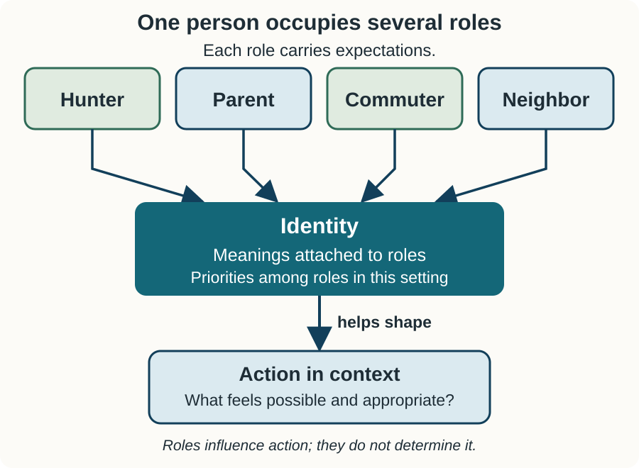
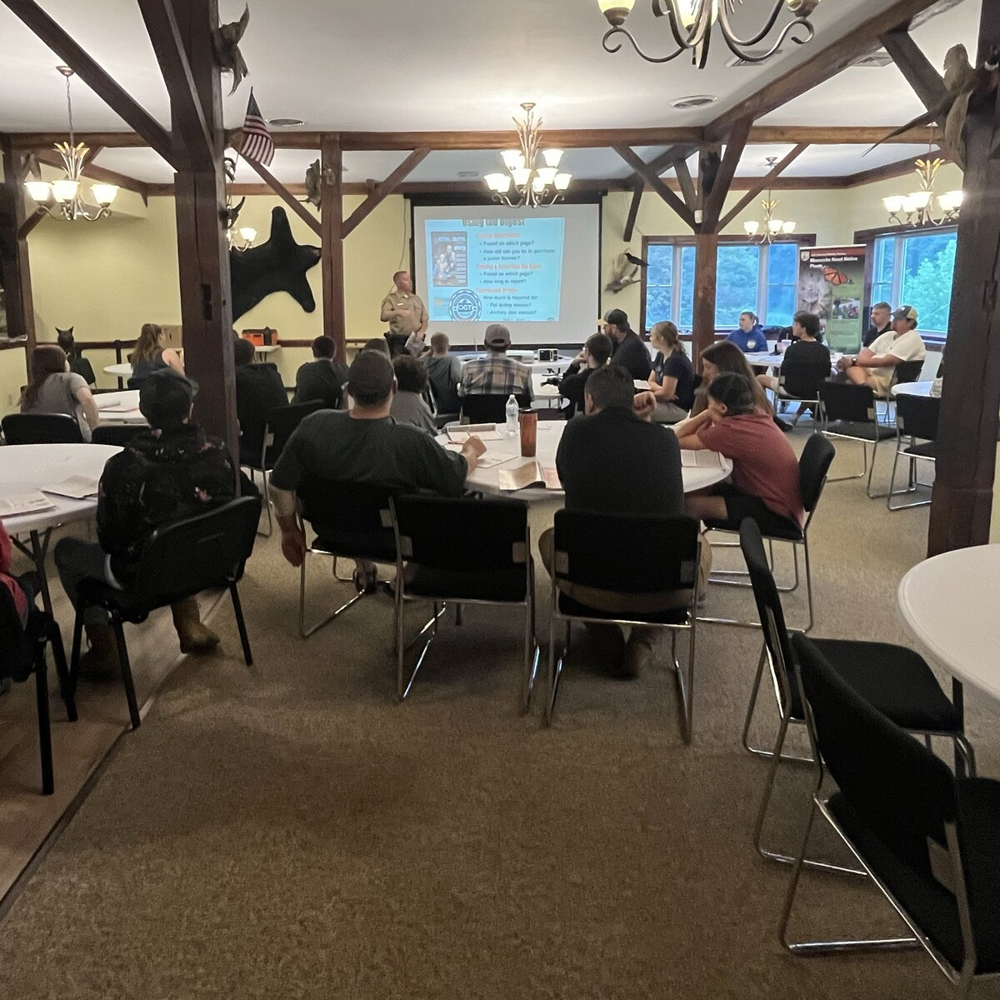

## Monday gave us the fundamentals

Structure and agency. Social facts. Troubles and issues. Social construction.
Social order and social change.

<br>

Today: three **perspectives** that ask different questions of the same problem,
and the **core concepts** that explain how a person comes to participate at all.

::: notes
Time: 2 minutes. Source: Chapter 9, §§9.4--9.6. Reconnect to Week 6: paradigms
shaped what counts as evidence; perspectives shape what counts as the question.

**Pacing.** Full deck is 50 minutes; the core path is 44. Slides marked "If time
is short, skip this slide" are the drop list: socialization-can-exclude and
community-based conservation. Protect the three perspectives, roles and
identities, Box 9.2, and the two core socialization slides --- they are
necessary for Friday's case roles.
:::

## Today's question

Three sociologists examining the same decline in participation would ask
different questions based on their theoretical perspectives:

1. What role does participation serve in maintaining social stability, and what
   happens to the larger social system when participation declines?
2. Who benefits from the decline in participation? How do power, inequality, and
   access to resources influence who participates and who does not?
3. What does participation mean to individuals? How do everyday interactions,
   identities, and shared meanings influence their decisions to participate?

::: notes
Time: 1 minute. Source: Chapter 9, §9.4 and Table 9.1. Write it on the board.
Friday does not require students to pick a perspective, but items 2 and 3 reward
a student who can hear which one a claim is coming from.
:::

## What you should be able to do

By the end of today, you should be able to:

- distinguish **functionalism**, **conflict**, and **symbolic interactionism**;
- explain **roles** and **identities** as socially constructed;
- explain **socialization** through agent, target, and context; and
- use **community**, **place**, and **stratification** to say who is served and
  who is not.

::: notes
Time: 1 minute. Source: Chapter 9, §§9.4--9.6.4. These map onto Friday's items
2, 3, and 4.
:::

## The Three perspectives {.section-slide background-color="#123f5a"}

<br>

Functionalism · Conflict · Symbolic interactionism

::: notes
Time: 1 minute. Source: Chapter 9, §9.4 and Table 9.1.
:::

## What each one asks

```{r}
#| echo: false
#| output: asis

source("../table-style.R")
data.frame(
    Perspective = c("Functionalism", "Conflict", "Symbolic interactionism"),
    `View of society` = c(
        "Interdependent institutions maintaining the whole",
        "Competition for resources and power; winners and losers",
        "Meaning negotiated through everyday interaction"
    ),
    `Question` = c(
        "How do the parts relate and produce this outcome?",
        "Who wins, who loses, and what sustains that pattern?",
        "How do people construct meaning through interaction?"
    ),
    check.names = FALSE
) |>
    nres315_slide_table(font_size = 22, header_font_size = 24, row_padding = 10)
```

::: notes
Time: 2 minutes. Source: Chapter 9, §9.4 and Table 9.1. Preview the three
perspectives before examining each in depth. Emphasize that none is "the right
one" --- they are complementary analytical frameworks that make different
aspects of a conservation problem visible.
:::

## Functionalism: parts maintaining the whole {.smaller}

Society is an **interdependent system** where specialized institutions work
together to maintain stability, equilibrium, and social order.

- **Interdependence:** Institutions fit together like organs in a body
- **Manifest functions:** Recognized and intended outcomes (regulating harvest)
- **Latent functions:** Unintended or unrecognized benefits (intergen. bonding)
- **Dysfunctions:** Disruptions that destabilize the system (participation drops
  and agency funding models fail.

::: {.key-idea}
When one component of the conservation system fails, the disruption ripples
across the entire social equilibrium.
:::

::: notes
Time: 3 minutes. Source: Chapter 9, §9.4.1. Use the organism analogy: each part
serves a function necessary for the whole. In wildlife management, the North
American Model created an interdependent cycle: hunters purchase licenses, funds
support habitat and public lands, harvest regulates populations, and rural
communities host the tradition. A drop in participation is not just an
individual choice; it is a system dysfunction that threatens agency budgets,
herd management, and rural economies.
:::

## Conflict theory: power, resources, and inequality

Society is characterized by pervasive inequality and struggle over **scarce
resources**, where dominant groups shape institutions to protect their
advantages.

- **Competition:** Resources like land, wildlife, funding, and decision
  authority are scarce; groups compete to control them.
- **Winners and losers:** Policies and social arrangements are rarely neutral;
  they consistently advantage some groups while marginalizing others.
- **Stratification in access:** When private lands are leased to high-paying
  nonresidents, affluent hunters gain exclusive access while local working-class
  hunters are priced out.
- **Institutional power:** Traditional agency structures historically prioritize
  license buyers over non-consumptive or underrepresented publics.

::: {.key-idea}
Conservation arrangements are not neutral --- they reflect and reinforce unequal
distributions of power and wealth.
:::

::: notes
Time: 3 minutes. Source: Chapter 9, §9.4.2. Conflict theory asks who benefits
and who loses. In natural resources, wildlife is held in the public trust for
all citizens, but access to wildlife is frequently controlled by private
property and capital. When commercial leasing expands, landowners and affluent
out-of-state hunters benefit, while local residents who hunted on a handshake
for generations are excluded. This directly links to Friday's stratification and
access data.
:::

## Symbolic interactionism: shared meanings

A micro-level lens: society is created and recreated through everyday
**interactions, language, and shared symbols**.

- **Meaning guides action:** People act based on the meanings things hold for
  them, not biophysical facts alone.
- **Meanings are socially constructed:** Meanings arise, are sustained, and
  change through face-to-face interaction with family, peers, and mentors.
- **Symbols in conservation:** A firearm, a deer camp, or the phrase "outdoor
  heritage" are symbols carrying deep cultural and personal meanings.
- **Negotiated reality:** If the everyday social interactions that reinforce
  those meanings disappear, the activity loses its significance.

::: {.key-idea}
Participation depends on the meanings people construct through social
relationships --- not simply individual preference or information.
:::

::: notes
Time: 3 minutes. Source: Chapter 9, §9.4.3. Shift from macro structures (systems
and classes) to the micro level: how do people make sense of their world? Why
does someone hunt? Not because an agency ran an ad, but because everyday
interactions with family or peers made it meaningful. If those everyday
interactions disappear --- elders pass, peers move, nobody invites you along ---
the activity loses its shared meaning. This sets up our discussion of roles,
identities, and socialization.
:::

## Three lenses on declining access

Three sociologists examine the exact same 44% decline in resident licenses:

::: {.columns}
::::: {.column .compact width="33%"}
**Functionalism**

*System stability*

- What function did walk-in access serve in the system?
- How does lost revenue disrupt agency operations?
- How can balance be restored?
:::::
::::: {.column .compact width="33%"}
**Conflict**

*Power & inequality*

- Who gained access when residents lost it?
- How does wealth dictate who hunts?
- Whose interests are served by commercial leasing?
:::::
::::: {.column .compact width="33%"}
**Interactionism**

*Meaning & identity*

- What does "being a hunter" mean to residents now?
- How did losing mentors alter participation?
- Whose "heritage" is being celebrated?
:::::
:::

::: {.key-idea}
No perspective is "the right one." Each asks a different question and reveals a
different mechanism for the same problem.
:::

::: notes
Time: 3 minutes. Source: Chapter 9, §9.4 and Table 9.1. Emphasize that these
three perspectives do not contradict each other; they illuminate different
dimensions of the same reality. Notice how this explains why the 2022 $140,000
advertising push failed: it assumed an information deficit, ignoring system
dysfunction (functionalism), land privatization (conflict), and severed social
ties (interactionism).
:::

## From perspectives to participation

<br>

::: {.columns}
::::: {.column .compact width="42%"}
Symbolic interactionism asks how interaction produces shared meanings.

<br>

**Roles** are social positions carrying expectations for behavior.

<br>

**Identity** is the meaning a person attaches to themselves based on how they
understand and prioritize those roles.
:::::
::::: {.column width="58%"}
{width="100%" fig-alt="One Cedar County resident occupies the roles of hunter, parent, commuter, and neighbor. Each role carries expectations. The meanings attached to those roles and the priorities among them contribute to identity, which helps shape what actions feel possible and appropriate in context without determining action."}
:::::
:::

::: notes
Time: 3 minutes. Source: Chapter 9, §9.6.1. Walk through one Cedar County
resident who is simultaneously a hunter, parent, commuter, and neighbor. The
arrows mean influence, not determination. Hunter identities are shaped by
material factors too --- weapon type, method, target species --- plus social
class, residency, and particular landscapes. That is why agencies should segment
hunter typologies rather than treat participants as one uniform group. "Hunters
support this" is usually a claim that has not been checked. Close by asking
where people learn the expectations attached to these roles; that question opens
the socialization section.
:::

## Socialization {.section-slide background-color="#2f6b57"}

Where do role expectations and shared meanings come from?

<br>

**Socialization** is how people learn the beliefs, values, norms, behaviors, and
role expectations of their culture.

::: notes
Time: 1 minute. Source: Chapter 9, §9.6.2. Open by noting that fish and wildlife
management relies heavily on voluntary compliance --- so how people are
socialized into expected standards is not a side topic.
:::

## Agent, target, context

<br>

::: {.columns}
::::: {.column .compact width="48%"}
- **Agent** --- the person or institution doing the socializing.
- **Target** --- the person being socialized.
- **Context** --- the setting in which it happens.

<br>

**Primary socialization** happens through parents in childhood. **Secondary
socialization** happens through peers, teachers, extended family, media, and
institutions.
:::::
::::: {.column width="52%"}
{width="100%" fig-alt="Adults seated at tables listen to an instructor during a hunter-education class at Cherry Valley National Wildlife Refuge. The classroom demonstrates an institution acting as a secondary socialization agent."}
:::::
:::

::: notes
Time: 3 minutes. Source: Chapter 9, §9.6.2 and Box 9.2. These three variables
are the analytic tool for Friday's item 3. Have students name the agent, target,
and context in their own introduction to any outdoor activity --- without
requiring anyone to share. In the photograph, the instructor and institution are
agents, the participants are targets, and the hunter-education class is the
context. Photograph: USFWS, public domain.
:::

## Which mattered more: agent or context?

The role of gender, rural upbringing, and whether the respondent's father
hunted.

- 82% of males with a hunting father had tried hunting --- and rural versus
  urban upbringing made **no difference** (81% vs. 83%).
- For females with a hunting father, the effect was modest: 27%.
- For females **without** a hunting father: 6%, with rural upbringing making no
  difference.

<br>

::: {.key-idea}
The presence of a hunting agent in the household mattered more than the rural or
urban context in which socialization took place.
:::

::: notes
Time: 3 minutes. Source: Chapter 9, Box 9.2. Present these as findings about
socialization mechanisms, not as claims about who ought to hunt. The striking
result is that a primary agent made context nearly irrelevant.
:::

## When does rural upbringing matter?

Exactly one case: **males who grew up rural without hunting fathers** were far
more likely to have tried hunting (59%) than urban males without hunting fathers
(34%).

<br>

::: {.key-idea}
Rural upbringing fosters participation mainly by **standing in for absent
primary agents** --- other family, friends, or institutions step in where the
behavior is widely seen as normative.
:::

::: notes
Time: 4 minutes. Source: Chapter 9, Box 9.2. This is the slide that makes
Friday's Response C intelligible: if secondary agents substitute for absent
primary ones, then a program that supplies a mentor is intervening on the actual
mechanism. No corresponding effect was observed for females, which the chapter
connects to how normative the behavior is for each group.
:::

## Socialization can also exclude

Media can act as a secondary socialization agent, communicating who appears to
belong.

<br>

Carini and Weber found that angling magazines showed women as:

- underrepresented relative to their actual participation;
- depicted in stereotypical roles, usually accompanied by men; and
- overtly sexualized.

::: {.key-idea}
When images reinforce a male-centric social space, people may not see themselves
as suitable members of the group.
:::

::: notes
Time: 3 minutes. Source: Chapter 9, §9.6.2. Media is a secondary socialization
agent, and it operates whether or not an agency intends it to. Keep this
analytic; the point is the mechanism, not an indictment of a magazine.

**If time is short, skip this slide.** The thread survives without it.
:::

## From socialization to community {.section-slide background-color="#123f5a"}

<br>

Socialization agents do not operate in isolation. Their relationships and
institutions are organized within communities.

<br>

**Community** is the intermediary space between the individual and broader
society.

::: notes
Time: 1 minute. Source: Chapter 9, §9.6.3. Name the shift in scale: the previous
slides examined how people learn meanings; the next slides examine the local
relationships and institutions through which that learning and participation
occur.
:::

## Three elements of community

- **Local territory** --- a specific physical setting.
- **Local society** --- the structures and institutions that meet local needs.
- **Social interaction** --- active engagement of people with one another.

<br>

Together, these elements make community **place-specific**. They also allow a
community to act in ways that cannot be predicted by averaging individual
attitudes.

::: notes
Time: 3 minutes. Source: Chapter 9, §9.6.3. Note the second element for Friday:
when the institutions that met local needs disappear, the community can persist
in territory while losing the structures that carried a practice. Use a local
ordinance as the example of collective action: it may be a compromise that
reflects nobody's average view.
:::

## Does local control guarantee equitable conservation?

No. Locally designed institutions can outperform centralized management, but
success depends on context and the robustness of the process.

<br>

- **Credibility:** do short-term local interests override broader goals?
- **Capacity:** technical expertise, management skill, finances, political
  access.
- **Power:** collaboration can be derailed when elite factions hold
  disproportionate influence.

::: {.key-idea}
Without these assets, community-based approaches can reinforce existing
inequalities rather than correct them.
:::

::: notes
Time: 3 minutes. Source: Chapter 9, §9.6.3. This is a direct callback to Week
5's collaboration material. "Community-led" is not a synonym for "equitable,"
and Friday's item 4 asks who a recommendation does not serve.

**If time is short, skip this slide.** The thread survives without it.
:::

## Why communities can reproduce inequality

**Stratification:** the processes allocating resources and opportunities by
hierarchical ranking or socially agreed criteria. **Inequality:** the uneven or
unfair distribution that results.

<br>

- The cost of equipment, transportation, and access can become prohibitive.
- Agencies risk losing large segments of their user base who can no longer
  afford to participate.
- Public trust thinking holds that wildlife is not owned by any group but held
  for the public benefit --- which makes equity a trust obligation, not a
  preference.

::: notes
Time: 3 minutes. Source: Chapter 9, §9.6.4. Close the loop to Week 5 explicitly:
the funding structure that positions license buyers first is a stratification
fact with a governance consequence. On Friday, the rise in leased-land
nonresident hunts is the stratification evidence.
:::

## Pair rehearsal: name the perspective

With a partner, name the perspective behind each claim:

<br>

1. "The walk-in program held the access system together; what changed when it
   shrank?"
2. "How do rising nonresident leases and declining resident access reveal
   unequal opportunities?"
3. "'Heritage' means something different now than it did when my father said
   it."

::: notes
Time: 4 minutes. Source: Chapter 9, §9.4. Answers: functionalism, conflict,
symbolic interactionism. These are interpretive claims to examine, not
established causal findings. The brief shows shrinking walk-in acreage and
rising nonresident leased-land licenses; it does not prove everything downstream
failed. The third paraphrases the meaning question in Friday item 3.
:::

## Friday

Read the **Week 08 Case Brief: Who Still Hunts Cedar County?** before class. It
supplies the case facts; Chapter 9 supplies the concepts.

<br>

Licenses down 44% in twenty years. County population nearly flat. Farm
operations down from 1,290 to 610. Posted acres up from 61,000 to 219,000.

::: notes
Time: 2 minutes. Source: Chapter 9, §§9.3--9.6. Tell students the roles this
week are social structure lead, meaning and identity lead, and community and
consequences lead. Repeat the frame: the county is fictional, no claim is made
about any real community, and nobody is asked about their own background.
Require one complete response A, B, or C within $260,000. Every pair exceeds the
budget; no component prices support a scaled combination. Protect the indicator
and revision trigger required in item 4.
:::

## Close

::: {.key-idea}
A useful response matches the diagnosed mechanism --- structure, socialization,
meaning, community capacity, or unequal access --- and states plainly what and
whom it leaves out.
:::

::: notes
Time: 1 minute. Source: Chapter 9, §9.7. Preview Week 9: economics, where those
same distributional questions are examined through incentives and market and
nonmarket values. Monday, October 19 is fall break; the usual Sunday quiz
deadline remains, and the integrated lesson is Wednesday, October 21.
:::
