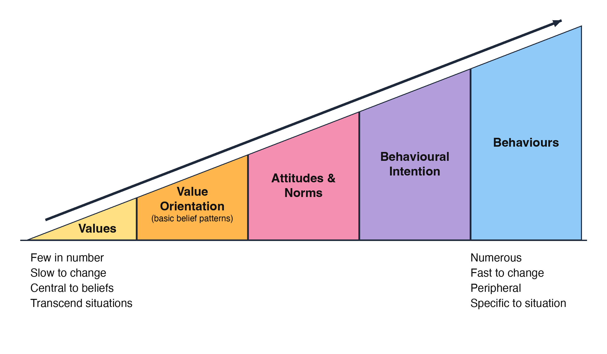
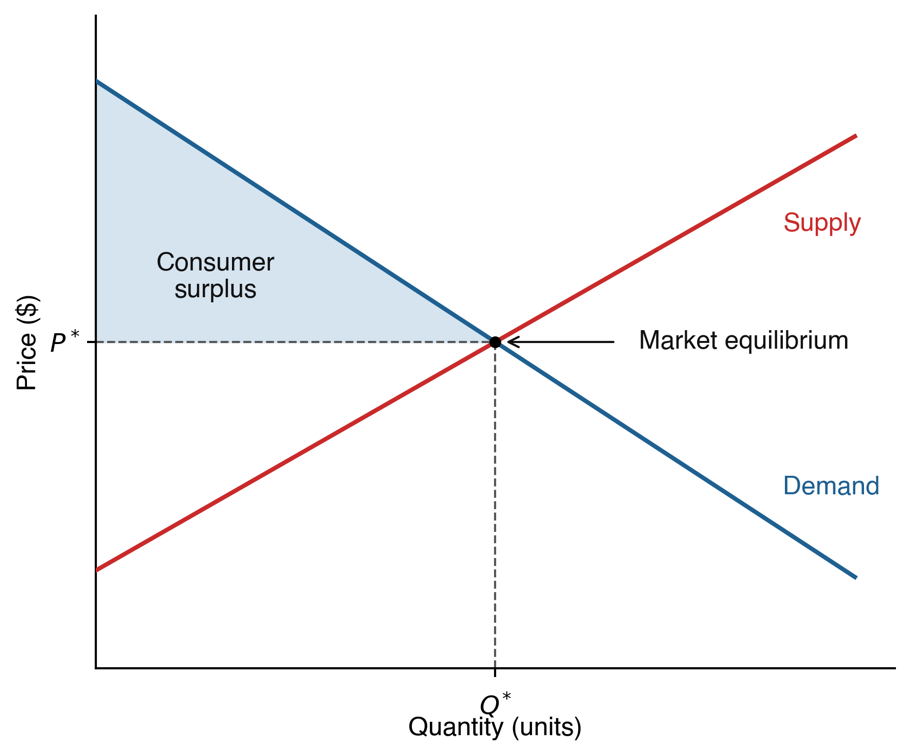
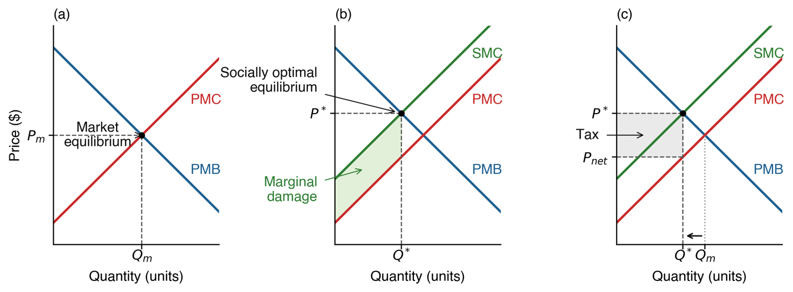
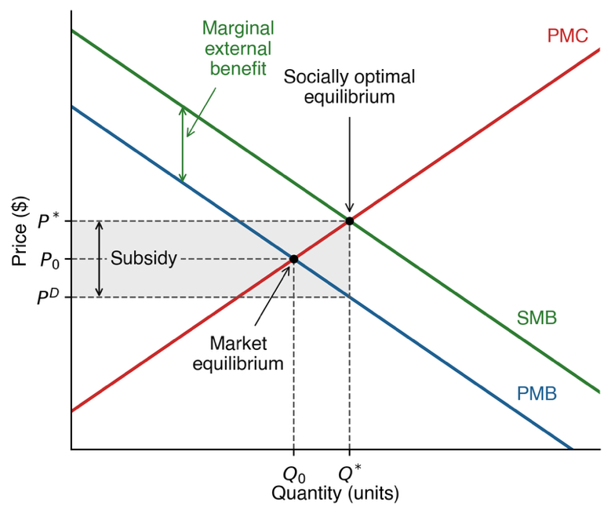

## A streamside decision

A watershed partnership wants landowners to restore **riparian buffers**:
vegetated strips beside streams.

 

Buffers may improve water quality and wildlife habitat. Landowners bear
installation, maintenance, and foregone agricultural income.

 

**Who should pay for benefits that extend beyond the property?**

::: notes
Time: 2 minutes. Source: Friday Case Brief 09; Chapter 10. Introduce the composite case before the economic vocabulary. These are potential benefits, not measured outcomes. Monday was fall break; this is the integrated Wednesday lesson. Two alternatives recur throughout: voluntary cost-share and a buffer requirement conditional on authority. No real-program payment rates apply. Detailed grounding: Chapter 10, §10.3.3 and Box 10.4.
:::

## What you should be able to explain

- Connect earlier social values to economic value without treating them as identical.
- Explain how rights, costs, and incentives affect conservation.
- Distinguish price, nonmarket value, and who gains or pays.
- Compare alternatives and identify evidence that could change a recommendation.

::: notes
Time: 1 minute. Source: Chapters 1, 3, 6, 8, and 10. The value bridge is a new explicit learning outcome. The remaining outcomes prepare students for the four Friday response sections. No new calculation requirement is added.
:::

## The questions carry forward

**Module 01:** Which outcomes and actions do people consider desirable?

 

**Module 02:** Who benefits from public trust resources, now and in the future?

 

**Module 04:** How do values and evidence inform a decision?

 

**Module 09:** What benefits, costs, and tradeoffs follow from each choice?

::: notes
Time: 1 minute. Source: Chapters 1, 3, 6, and 10. Return to the first lecture: evidence describes conditions and consequences; values shape desired outcomes. Public trust broadens whose interests count beyond current paying users. Economic analysis contributes evidence about consequences; it does not select society's objectives by itself.
:::

## Social values and economic value

::: {.columns}
::::: {.column width="48%"}
**Social values**

Beliefs about desirable outcomes and ways to act.

“We should leave healthy streams for future generations.”
:::::
::::: {.column width="48%"}
**Economic value**

Benefits people derive from a resource or a specified change, reflected in tradeoffs.

“What would preserving this stream mean for people's well-being?”
:::::
:::

 

Values help explain **why an outcome matters**. Economic valuation examines
**benefits and tradeoffs for a particular change**.

::: notes
Time: 2 minutes. Source: Chapters 1 and 10. Grounding: Chapter 1 §1.2.1 and Chapter 10 §10.3, Key Point: Values in Economics. Here social values refers to beliefs about desirable outcomes/actions; do not claim all members of a public share one value. Economic utility means perceived benefit or satisfaction, not usefulness for profit. Nonmarket benefits are economic benefits too. The example is illustrative, not a survey finding.
:::

## From broad values to a specific choice

::: {.columns}
::::: {.column width="53%"}
{width="100%" fig-alt="The cognitive hierarchy connects broad values and value orientations to specific attitudes and norms, intentions, and behavior. Values are relatively stable; specific choices depend more on the situation."}
:::::
::::: {.column width="43%"}
**Recall Module 07.**

Caring about stewardship can shape support for a buffer.

Enrollment also depends on costs, available time, control, and expected results.

A value orientation does not convert directly into a dollar amount.
:::::
:::

::: notes
Time: 2 minutes. Source: Chapters 8 and 10. Grounding: Chapter 8 §8.4.1 and Figure 8.1; Chapter 10 Key Point: Values in Economics. Do not add willingness to pay as a universal stage of the cognitive hierarchy. The diagram explains a connection, not a deterministic causal chain. Economic preference is specific to the proposed change and alternatives; behavior also depends on constraints.
:::

## The same concern can produce different choices

Two landowners may both care about the stream.

 

One can afford to remove a strip from production. The other depends on that
income and cannot cover installation.

 

**Willingness to pay reflects preferences and ability to pay.**
A smaller dollar amount does not establish less concern.

 

An interview about stewardship and a valuation survey answer different questions.

::: notes
Time: 1 minute. Source: Chapters 8, 9, and 10. Illustrative contrast, not measured case evidence. Chapter 10 defines demand and willingness to pay in terms of willingness and ability; Chapter 9 stratification explains unequal opportunities. Distinguish valuing the outcome, supporting a policy, and being able to enroll. This is also why economic valuation is not a complete measure of social importance or ethical obligation.
:::

## Scarcity makes every choice a tradeoff

**Economics** examines how people allocate limited resources.

 

A buffer uses land, labor, time, and money that could serve another purpose.

 

**Opportunity cost:** the value of the next-best alternative given up.
For a landowner, that may include foregone agricultural income.

 

A payment changes who pays; it does not remove the tradeoff.

::: notes
Time: 2 minutes. Source: Chapter 10; Friday Case Brief 09. Grounding: Chapter 10 §§10.2–10.3 and Box 10.4; case Exhibit A. Opportunity cost is a teaching synthesis of scarce-resource allocation and the chapter's income-foregone example. Count the relevant foregone net return, not both gross revenue and the production costs avoided. Public funding also has alternative uses.
:::

## How markets coordinate choices

::: {.columns}
::::: {.column width="44%"}
**Demand:** quantity buyers are willing and able to buy at different prices.

**Supply:** quantity producers are willing to provide at different prices.

**Equilibrium:** quantity demanded equals quantity supplied.
:::::
::::: {.column width="52%"}
{height=410px fig-alt="Price is on the vertical axis and quantity on the horizontal. Demand slopes down and supply slopes up. Their intersection determines equilibrium price and quantity. The shaded area below demand and above price is consumer surplus."}
:::::
:::

::: notes
Time: 2 minutes. Source: Chapter 10. Grounding: §10.3, original Figure 10.1 extracted unchanged from the course EPUB. Read the axes first, then trace the two curves. Hold other factors constant. Equilibrium describes exchange; it does not establish that unpriced environmental consequences are accounted for. The next slide explains the shaded area.
:::

## Price and benefit are different quantities

**Consumer surplus** is willingness to pay minus the price actually paid.

 

Illustration: someone would pay **$30** for a visit and pays a **$10** fee.
The surplus is **$20**, holding other costs aside.

 

The fee records a payment. It does not record the entire benefit of the visit.

 

Likewise, recreation spending alone misses benefits to users and nonusers.

::: notes
Time: 2 minutes. Source: Chapter 10. Grounding: §10.3 definition of consumer surplus and §§10.4–10.5. The numbers are a deliberately simplified teaching illustration, not case evidence. The demand curve represents willingness to pay; the price line shows what is paid. Do not add spending indiscriminately to consumer surplus in a social benefit-cost analysis: define the perspective and relevant resource costs. A free visit can still yield a benefit.
:::

## Economic value includes nonmarket benefits

**Market transactions:** crops, equipment, labor, or a paid recreation service.

 

**Nonmarket benefits:** an enjoyable wildlife encounter, cleaner water, or
knowing habitat persists without a direct sale of that benefit.

 

One resource can provide both. **Market/nonmarket describes exchange;
use/non-use describes how the benefit arises.**

::: notes
Time: 1 minute. Source: Chapter 10. Grounding: §§10.4–10.4.1. Do not present social and economic value as separate competing buckets. A socially valued outcome may generate economic benefits without a market price. Charging for access does not price every benefit, and paying to install a buffer does not measure its total value.
:::

## Use values: experience and ecological support

**Direct use:** fishing, hunting, wildlife viewing, or hiking.

 

**Indirect use:** ecological functions that support other benefits, such as
nursery habitat supporting a fishery or wetlands reducing flood damage.

 

For our case, identify the **ecological change**, the **benefit**, and the
**people receiving it**. Their magnitude still needs evidence.

::: notes
Time: 2 minutes. Source: Chapter 10; Friday Case Brief 09. Grounding: §10.4.1 and case Exhibit B. Direct use can be consumptive or nonconsumptive. Indirect does not mean weak or unimportant. Restoring private land does not grant public entry. Avoid double counting a supporting ecological function and the same final benefit it produces; this is an accounting caution, not an additional assignment requirement.
:::

## Value can extend beyond current use

- **Option:** keeping the possibility of using the resource yourself later.
- **Bequest:** conserving it for future generations.
- **Existence:** valuing its continued existence even if you never use it.

 

A concern for future generations can motivate **bequest value**.
A visitor count will not reveal that full benefit.

::: notes
Time: 2 minutes. Source: Chapters 1, 3, and 10. Grounding: Chapter 10 §10.4.1 and Chapters 1/3 on values and beneficiaries. Ask students to distinguish “I might visit,” “my grandchildren could benefit,” and “I want the species to persist even if no one in my family visits.” Existence value remains a benefit perceived by people; it is not identical to the ethical claim that nature has intrinsic value independent of humans.
:::

## Value the change the decision would cause

**Total economic value** includes direct, indirect, option, bequest, and
existence benefits.

 

**Marginal value** concerns an additional unit or increment.

 

The board needs the value of **additional restoration compared with no new
program**, not the value of the entire watershed.

 

The next restored parcel need not provide the same benefit as the first.

::: notes
Time: 1 minute. Source: Chapter 10; Friday Case Brief 09. Grounding: §10.4.1 and §10.5.4. Total economic value is a scope of benefits, not a synonym for market revenue or an unlimited justification for any project cost. The marginal-value point helps students compare changes in placement/amount. Do not assume a linear value per acre; the case gives no estimates.
:::

## Property rights shape the available choices

Rights may include **access, use, management, exclusion, and transfer**.

 

A landowner's ability to manage a buffer is different from an angler's right
to enter that property.

 

A partnership's ability to fund restoration is different from authority to
require it.

 

Rights affect incentives, investment, and whose opportunities are protected.

::: notes
Time: 1 minute. Source: Chapters 3, 5, and 10; Friday Case Brief 09. Grounding: Chapter 10 §10.3.1/Table 10.1, earlier public trust/governance, case Exhibit A. Do not equate private land with private ownership of all wildlife or public trust beneficiaries with unrestricted access. Secure rights can support stewardship while uneven allocations can exclude others. Optional fisheries example appears after the core lesson.
:::

## Two questions distinguish four kinds of goods

**Excludability:** can access be restricted?
**Rivalry:** does one person's use leave less for others?

 

::: {.columns}
::::: {.column width="48%"}
**Private:** excludable + rivalrous.\
A harvested fish sold for food.

**Club:** excludable + largely non-rivalrous.\
Member access before congestion.
:::::
::::: {.column width="48%"}
**Common-pool:** hard to exclude + rivalrous.\
A fish stock subject to harvest.

**Public:** hard to exclude + non-rivalrous.\
Climate-regulation benefits.
:::::
:::

::: notes
Time: 2 minutes. Source: Chapter 10. Grounding: §10.3.2/Table 10.2. Examples apply the definitions; exclusion and congestion depend on institutions and context. Public good is not synonymous with publicly owned. A watershed contains multiple goods; do not classify the entire place as one type. Link rival harvest to overuse and non-excludable benefits to difficulty collecting voluntary payments.
:::

## Private incentives can miss public consequences

**Negative externality:** a decision imposes an uncompensated cost on others,
such as downstream damage from runoff.

 

**Positive externality:** a decision benefits others without fully rewarding
the provider, such as habitat benefits from a buffer.

 

**Social costs and benefits** include effects beyond the decision-maker.
Here “social” means society-wide accounting.

::: notes
Time: 2 minutes. Source: Chapter 10; Friday Case Brief 09. Grounding: §10.3.3. Externalities are unpriced effects beyond the transaction, not any effect on anyone. Private costs/benefits can therefore diverge from social costs/benefits. Society-wide accounting is not the same concept as the social values discussed earlier. Use potential case consequences, not assertions of measured water-quality gains.
:::

## A policy can change incentives in either direction

**Market failure:** unpriced harm encourages too much damaging activity,
or unrewarded public benefits discourage conservation.

 

**Policy failure:** rules or subsidies create unintended harm.

 

A subsidy that lowers production costs may encourage expansion into habitat.
A conservation payment may encourage restoration.

 

Ask what behavior the rule actually rewards.

::: notes
Time: 1 minute. Source: Chapter 10. Grounding: §10.3.3 and Boxes 10.2–10.3. Teach the mechanism from the manuscript rather than claims about current program law. The chapter's water-allocation example shows how rewarding continued use can undermine conservation. Policy design, implementation, and coordination matter; government action is not automatically corrective.
:::

## Why a cost-share offer might help

The landowner pays restoration costs while some benefits reach other people.

 

**Cost-share** reimburses part of eligible practice costs.
**Payments for ecosystem services** pay for defined environmental services.

 

Both can change the incentive. Results still depend on participation,
placement, maintenance, and whether the expected service occurs.

::: notes
Time: 2 minutes. Source: Chapter 10; Friday Case Brief 09. Grounding: Box 10.4. Use cost-share versus service payment carefully: installing a practice is different from verifying an outcome. The fictional A shares installation costs only; do not import the real program's other eligible costs or payment rates. Ask whether a program produces restoration beyond what would occur anyway. Graphical mechanism is optional reference material.
:::

## Pair check: values, benefits, and incentives

Consider this illustrative statement:

> “I want my grandchildren to have a healthy stream, but I cannot afford to
> take productive land out of use.”

 

1. Name the social value and a related economic value.
2. Identify the constraint and a cost-share incentive.
3. Explain why declining to enroll would not prove a lack of concern.

::: notes
Time: 3 minutes. Source: Chapters 1, 8, and 10; Friday Case Brief 09. Two minutes in pairs and one minute debrief. Expected: stewardship/intergenerational concern; bequest benefit; foregone income plus installation costs; cost-share lowers a private financial barrier but does not necessarily cover foregone income. The statement is a teaching illustration, not case interview evidence. This checks the new bridge without adding a graded Friday deliverable.
:::

## Revealed preference: learn from actual choices

**Travel cost:** relate visits to travel expenses, fees, and time to infer
recreation demand and benefits.

 

**Hedonic pricing:** isolate how environmental conditions relate to property
prices while accounting for other features.

 

Observed choices help estimate use benefits. They miss people who value
conservation but never visit or buy property there.

::: notes
Time: 2 minutes. Source: Chapter 10. Grounding: §10.5.1. Travel-cost valuation is not just totaling gasoline receipts. Hedonic comparisons must separate environmental quality from house size, location and other features. Both need suitable data and assumptions; mere correlation or spending totals do not establish the value of proposed restoration. Access constraints also influence observed behavior.
:::

## Stated preference: ask about a defined change

**Contingent valuation:** ask whether people would pay a specified amount
for a specified outcome.

 

**Choice experiment:** compare alternatives that vary in outcomes and cost.

 

These can include nonusers and future-oriented benefits. Credible scenarios,
payment terms, and who is asked affect the result.

::: notes
Time: 2 minutes. Source: Chapter 10. Grounding: §10.5.2. Use the chapter's referendum format: support for a concrete conservation change at a specified annual cost. A question asking only “Do you support conservation?” is an attitude question, not a monetary valuation. Include an appropriate baseline/opt-out. Hypothetical responses and unrepresentative samples can limit inference. Willingness to accept compensation is another framing described in the chapter.
:::

## Benefit transfer: use evidence from another setting

Apply a previous valuation study to the policy setting.

 

**Value transfer:** adapt an existing estimate.
**Function transfer:** use a model that accounts for relevant differences.

 

Check the environmental change, affected population, substitutes, units,
and time period. A convenient number is not automatically a suitable one.

::: notes
Time: 1 minute. Source: Chapter 10. Grounding: §10.5.3. Lower cost and speed are advantages; comparability is the central limitation. This is not collecting a fresh stated-preference survey. Do not multiply a per-household annual benefit by acres. No outside study or transfer calculation is required Friday.
:::

## Choose the method for the missing benefit

**Recreation benefit:** travel-cost evidence may help.

 

**Existence or bequest benefit among nonvisitors:** a carefully designed
stated-preference study may help.

 

**Landowner enrollment:** ask about costs and participation conditions.

 

The best next evidence may concern feasibility rather than valuation.

::: notes
Time: 1 minute. Source: Chapter 10; Friday Case Brief 09. Ask which method could reach someone who never visits and why visitor spending cannot answer that question. Then distinguish a valuation question from the administrative question of who can implement B. This is an oral retrieval check, not a new method category or an instruction to collect data.
:::

## Benefit-cost analysis compares changes

1. Define the baseline, affected population, and time period.
2. Identify additional costs and benefits, including nonmarket effects.
3. Estimate those effects and put different years on a common basis.
4. Compare net benefits and report uncertainty and omitted effects.

 

**Net benefit = benefits − costs.**
A financial budget alone does not provide the full comparison.

::: notes
Time: 2 minutes. Source: Chapter 10. Grounding: §10.5.4, six steps consolidated for teaching. A complete comparison requires a defined geographic/social scope, ecological response estimates and monetary values. Net present value uses discounted benefits/costs. Avoid counting the same benefit twice. Friday supplies neither ecological nor valuation estimates, so no net-benefit result can be calculated.
:::

## Timing and uncertainty can change the result

Installation costs may occur now; habitat benefits may arrive later.

 

**Discounting** expresses effects in different years as present values.
A higher discount rate gives less weight to later benefits and costs.

 

Compare plausible assumptions about costs, outcomes, timing, and durability.
Report when the preferred alternative changes.

::: notes
Time: 1 minute. Source: Chapter 10. Grounding: §10.5.4, project horizon and social discount rate. Link to future beneficiaries from Module 02 and bequest value. Discounting is an accounting choice with consequences for long-lived projects, not a claim that future people care less. Sensitivity analysis here is a teaching application of uncertain estimates; no formula or calculation is assessed.
:::

## A positive total does not settle fairness

**Efficiency:** do the added benefits justify the resource costs?

 

**Distribution:** who gains, who pays, and who is missing?

 

An alternative can have positive net benefits while imposing serious burdens
on a particular group.

 

Recall public trust, inclusion, and governance: the decision also needs
legitimate authority and a fair process.

::: notes
Time: 2 minutes. Source: Chapters 3–6 and 10. Grounding: Chapter 10 §10.5.4 and earlier public trust/justice/governance. Aggregate willingness to pay is not a vote giving wealthier publics greater moral standing. Gains do not demonstrate that harmed people are compensated. An economic total informs a decision; it cannot by itself establish rights, consent, legitimacy or the acceptability of every tradeoff.
:::

## Changing the payer does not erase the cost

Under **A**, the partnership and enrolled landowner share installation costs.

 

Under **B**, the landowner pays installation costs; implementation still
requires administration and enforcement.

 

For a society-wide account, record installation resources once and track
how payment responsibilities shift.

 

Also identify maintenance, foregone income, and unequal ability to pay.

::: notes
Time: 1 minute. Source: Chapter 10; Friday Case Brief 09. Grounding: §10.5.4 and Exhibit A. This accounting application distinguishes a transfer between parties from use of real resources. The payment is an expense in the funder's budget and income/reimbursement to the recipient; do not add both as separate social costs within the same scope. Administrative costs remain resource costs. No invented dollar amounts.
:::

## Compare the two restoration alternatives

**A: voluntary cost-share**

Participation depends on whether the offer works for landowners and whether
needed parcels enroll.

 

**B: a buffer requirement**

Coverage depends on confirmed authority, implementation, and compliance.

 

With a partner: identify one likely tradeoff, one affected public, and the
missing evidence that matters most to your choice.

::: notes
Time: 3 minutes. Source: Friday Case Brief 09; Chapter 10. Two minutes in pairs and one-minute contrasting responses. A may leave important parcels unenrolled; B may impose burdens and cannot proceed on assumed authority. Neither outcome is established. Do not presume a requirement is more effective, or voluntary participation cheaper, without evidence. Both alternatives can earn full credit.
:::

## Turn an information gap into a decision rule

Name **what to learn**, **how to learn it**, and **whose information is needed**.

 

Then state:

**If we found \_\_\_, we would revise \_\_\_ because \_\_\_.**

 

For example, poor enrollment on priority parcels would be a reason to
reconsider an offer or the preferred alternative.

::: notes
Time: 1 minute. Source: Chapter 10; Friday Case Brief 09. Grounding: §10.5 and the brief's evidence-plan instructions. A directional finding is sufficient. Keep the example conditional; the case contains no enrollment measurements. A method name alone is not a plan. Costs, ecological effects, valuation, participation, or authority can be the deciding gap.
:::

## Bring the value connection back to the decision

**Social values** help define desirable outcomes and responsibilities.

 

**Economic values** describe benefits and tradeoffs for particular changes,
including benefits without a market price.

 

**A management decision** combines that evidence with distribution,
authority, and what affected publics consider acceptable.

::: notes
Time: 1 minute. Source: Chapters 1, 3, 6, 8, and 10. Exit check: ask for one sentence connecting stewardship, a bequest benefit, and a restoration cost. Correct “economic equals revenue,” “social values can be read directly from payment,” and “a positive total proves fairness.” Keep the bridge conceptually distinct from the psychological hierarchy while showing the relation.
:::

## Prepare for Friday, October 23

Read the **Case Brief** and find your preassigned group and role.

 

Submit the role record and four sections: **diagnosis; value and distribution;
recommendation; evidence and revision**.

 

**Due before 10:50 a.m.** Shared response: **80 points**.
Every present member completes the private **Group Check: 20 points**.

 

Identify the case evidence and chapter concept. Exact box or section numbers
are not required.

::: notes
Time: 1 minute. Source: Friday Application 09 and Group Check 09. No generative AI. Use the case brief and Chapter 10. No numerical BCA, outside research, or invented authority is required. Instructor accessibility checks: unique headings, described figures, reading order, slide fit, contrast, keyboard navigation, and printable companions. The following reference slides are outside the 50-minute core path.
:::

## Reference: a race to harvest

A shared catch limit may encourage people to harvest before others do.

 

Secure harvest shares can reduce that race and encourage longer-term planning.

 

But transfers can concentrate fishing rights. Ownership caps, community
provisions, and entry protections address different distribution concerns.

 

Changing incentives and protecting communities require attention to design.

::: notes
Time: 0 minutes. Source: Chapter 10. Optional reference, not part of core timing. Grounding: §10.3.1 and Box 10.1. The manuscript contrasts shared catch limits, individual transferable quotas/catch shares and territorial use rights. Secure shares do not substitute for a biologically appropriate harvest limit, monitoring, or safeguards. No claims about current regulations.
:::

## Reference: accounting for an external cost

{width="100%" fig-alt="Three panels show a negative externality. First, private benefit and private cost determine market output. Next, social marginal cost includes marginal damage and implies lower output. Finally, a corrective tax creates a wedge between the buyer price and the producer's net price, reducing output toward the social optimum."}

The unpriced harm creates a gap between **private cost** and **social cost**.

::: notes
Time: 0 minutes. Source: Chapter 10. Optional reference. Original Figure 10.2, unchanged from the EPUB. Read panels left to right. SMC = PMC + marginal damage; a properly calibrated tax can internalize that damage in the model. The figure illustrates the mechanism, not an estimated tax rate or policy recommendation for Friday.
:::

## Reference: rewarding an external benefit

::: {.columns}
::::: {.column width="51%"}
{height=420px fig-alt="Social marginal benefit lies above private marginal benefit because it includes benefits to others. Private demand and supply yield less activity than the social optimum. A subsidy can bridge the marginal external-benefit gap and encourage more activity."}
:::::
::::: {.column width="45%"}
Benefits reach people beyond the provider.

A subsidy can reward some of that external benefit.

Actual payment design requires evidence about costs, additional outcomes,
and participation.
:::::
:::

::: notes
Time: 0 minutes. Source: Chapter 10. Optional reference. Original Figure 10.3, unchanged from the EPUB; §10.3.3 and Box 10.4. SMB = private marginal benefit plus marginal external benefit. The model does not establish the appropriate payment rate for the fictional program. A practice payment is not automatically a verified ecosystem-service benefit.
:::
