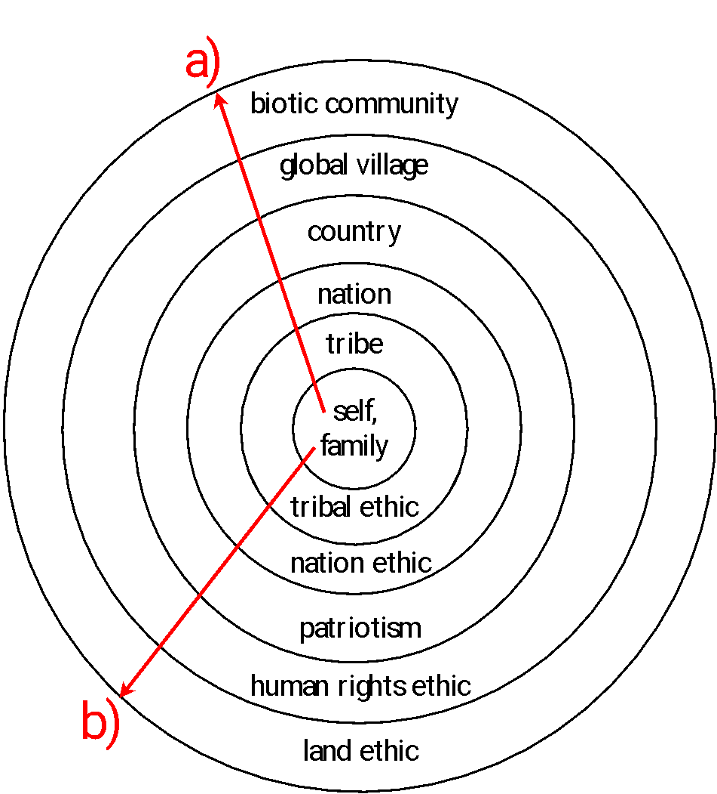

## A spring creek and two hundred bass

Sable Creek holds the only known population of the **Sable darter**.

 

Since illegally stocked bass arrived in 2023, the darter catch has fallen from
**410 to 97**.

 

Every option MDWP has costed kills different animals, or none.

 

**What should MDWP do, and on what grounds?**

::: notes
Time: 2 minutes. Source: Friday Case Brief 10; Chapter 11. Open with the composite case students read before class. Do not resolve it today. Name the tension: removing the bass kills animals, and doing nothing likely loses a species from the creek. This week is about how to reason through that, not about which answer is correct. All case facts are in the brief; no real stream or species is implied. Grounding: Chapter 11 §11.2 and Table 11.1, "removal of exotic species."
:::

## What you should be able to explain

- Separate descriptive from prescriptive claims in a management argument.
- Show why an ethical conclusion needs a fact and a value.
- Apply five ethical theories to the same decision.
- Distinguish moral agents from moral patients, and who counts from how much.

::: notes
Time: 1 minute. Source: Chapter 11, §11.1. These map to the module objectives and Friday's four items: premises (item 1), moral community (item 2), theory and objection (item 3), process and revision (item 4). Wednesday's take-home preparation completes the moral-community half.
:::

## The questions carry forward

**Module 01:** Which outcomes do people consider desirable?

 

**Module 03:** For whom are fish and wildlife held in trust?

 

**Module 09:** What benefits and costs follow from each choice?

 

**Module 10:** Which of those claims *ought* to decide it, and why?

::: notes
Time: 1 minute. Source: Chapters 1, 3, 10, and 11. Last week's economics described benefits to people, including nonmarket and existence value, and warned that a positive net benefit does not settle fairness. Ethics is where that question gets argued directly. Keep the bridge clear: existence value is a benefit people feel; intrinsic value, later today, does not depend on people feeling it.
:::

## Ethics is already in the mission

The Wildlife Society's vision (as of July 2024):

> "A world where wildlife and people thrive in resilient ecosystems."

 

*Why* should wildlife thrive? Because it is useful to people, or because it
matters for its own sake? What counts as **resilient**?

 

The statement cannot be carried out without answering ethical questions.

::: notes
Time: 2 minutes. Source: Chapter 11, §11.2. The chapter uses the vision and mission to show that goals rest on ethical commitments. Do not quiz on the exact wording. The review question at the end of Chapter 11 compares this with the 2012 vision; it is in the reference slides if time allows. Grounding: §11.2, opening paragraphs.
:::

## Many routine choices are ethical choices

| Challenge | One ethical question it raises |
|---|---|
| Restoration | Restore a state, a process, or a relationship? |
| Exotic species removal | When does the moral cost of killing exceed the benefit? |
| Population viability | How much risk is too much? |
| Hunting | Where should the burden of proof lie? |
| Sustainability | What counts as a human *need*, or a *healthy* ecosystem? |

::: notes
Time: 1 minute. Source: Chapter 11, Table 11.1. Abbreviated from the table; each row in the book has several questions, including Indigenous framings (reciprocity, Mitakuye Oyasin, Seventh Generation, humility) that we return to Wednesday. Point to row 2: Sable Creek is an exotic-species removal case, and the table's third question there, "is it wrong to remove exotics when so little is done to prevent their arrival?", is the Sable Creek angler's objection almost word for word.
:::

## Isle Royale: when even "natural" is unclear

Wolves on Isle Royale were nearly lost in the early 2000s, mainly because of
climate change.

 

The National Park Service hesitated. Was bringing in new wolves the right way
to offset human impacts, or did it violate the principle of interfering with
natural processes as little as possible?

 

The answer depends on what a **healthy ecosystem** means.

::: notes
Time: 1 minute. Source: Chapter 11, §11.2. The chapter names two common definitions of ecosystem health: providing what humans want, or being unaffected by humans. It calls both too narrow; the second assumes humans and nature are fundamentally separate. We will return to Isle Royale when we reach natural law. Grounding: §11.2, Isle Royale paragraphs; Box 11.3.
:::

## Describing the world versus prescribing action

**Descriptive** statements say what *is*.
"Deer density has doubled since 2015."

 

**Prescriptive** statements say what *ought* to be.
"There ought to be fewer deer on the landscape."

 

Most of the sciences study descriptive claims. **Ethics** analyzes
prescriptive ones: claims about how we ought to act, value, or relate to the
world.

::: notes
Time: 2 minutes. Source: Chapter 11, §11.2.1. Prescriptive statements typically use "ought" or "should." Ethics is defined in the chapter as the formal and rigorous analysis of propositions about right and wrong; the deer and wolf examples are the chapter's. Note that "fewer deer" may be a conclusion people reach from data, but the data alone do not contain the "ought."
:::

## Sort these claims

1. Darter catch fell from 410 in 2021 to 97 in 2026.
2. MDWP should remove the bass from Sable Creek.
3. Fish can experience pain during electrofishing.
4. We should not cause animals unnecessary suffering.
5. A state agency ought to protect species found nowhere else.

 

Which are **descriptive** and which are **prescriptive**?

::: notes
Time: 2 minutes. Source: Chapter 11, §11.2.1; Friday Case Brief 10. Thirty seconds alone, then call on students. Answers: 1 and 3 descriptive; 2, 4, and 5 prescriptive. Item 3 is descriptive even though it is morally loaded; whether it is true is a scientific question. The brief deliberately leaves it unsettled for Sable Creek fish. Correct the common error that any sentence about animals' welfare is "ethical" rather than factual.
:::

## An ethical conclusion needs a fact and a value

**Premise 1 (fact):** Fish can experience pain and suffering caused by
catch-and-release fishing.

**Premise 2 (value):** We should not cause unnecessary pain and suffering.

**Conclusion:** We should refrain from catch-and-release fishing, or
electrofishing, unless it is necessary.

 

::: {.key-idea}
Science can test premise 1. It cannot, by itself, establish premise 2.
:::

::: notes
Time: 3 minutes. Source: Chapter 11, §11.2.1, Key Point: Ethics Requires Facts and Values. This is the chapter's own example; quote it exactly. If premise 2 is true and premise 1 is true, the conclusion follows. Disagreement can therefore come from either premise. Many arguments that look like "science versus values" are really disputes about one premise that people have not separated. Note the word "unnecessary": much of the work happens there.
:::

## Build the Sable Creek argument

Fill in the structure for **one** alternative.

 

**Fact:** something in Exhibit A or B of the brief.

**Value:** a principle about what MDWP owes, and to whom.

**Conclusion:** "MDWP should ..."

 

Then ask: if the factual premise turned out false, would you change the
conclusion?

::: notes
Time: 3 minutes. Source: Chapter 11, §11.2.1; Friday Case Brief 10, Exhibits A–B. Ninety seconds in pairs, then share. Collect one argument for A and one for D. Typical value premises: "a state agency should conserve species found nowhere else"; "we should cause the least animal death possible." Point out that the statute's direction to "conserve listed species" is a legal fact; the claim that MDWP *should* obey it in a particular way still needs a value premise. This rehearses Friday item 1.
:::

## Ethics and morals are not the same word

**Ethics:** social standards of right and wrong within a culture or group,
and the discipline that studies them.

 

**Morals:** an individual's own compass of right and wrong.

 

An agency acts within professional and public ethics. Each biologist on the
crew also brings personal morals.

::: notes
Time: 1 minute. Source: Chapter 11, §11.2.1, Did You Know. The chapter acknowledges the terms are often used interchangeably. Keep this brief; it matters for Friday only in that personal discomfort is not the same as an ethical argument the agency can defend publicly.
:::

## Four objections to taking ethics seriously

- "Ethical disagreements are intractable."
- "Ethics is subjective; only science is rational."
- "Right and wrong are only true from one culture's point of view."
- "Ethics is a way to tell other people what to do."

 

Chapter 11 answers each: ethics, like science, depends on rigorous argument
and can reach consensus.

::: notes
Time: 1 minute. Source: Chapter 11, Box 11.2. Briefly give the chapter's responses: R1, consensus is possible through ethical discourse, as in science; R2, genuine ethical discourse uses rational, assessable arguments, and science is not always as objective as assumed; R3, shared human attributes and interests may make some values nearly as universal as empirical premises; R4, ethics is primarily bottom-up, about understanding how best to live. Ask which objection students have heard most often.
:::

## Five theories ask different questions

One question from §11.3: when an agency sets an annual fish harvest, what
should drive it?

 

- **Consequentialism:** which allocation produces the best outcomes?
- **Deontology:** which duties and rights must be honored?
- **Natural law:** which allocation follows natural processes?
- **Virtue theory:** what would a good professional do?
- **Relational theory:** what do our relationships require?

::: notes
Time: 1 minute. Source: Chapter 11, §11.3. The chapter's opening example offers three drivers: benefits to fishers (consequentialist), mimicking natural processes (natural law), and a principle of distributive justice (deontological). Virtue and relational theory are added from §§11.3.4–11.3.5 for completeness. The next five slides take one theory each. Divine command theory is in the chapter with natural law; mention it there.
:::

## Consequentialism: judge the outcome

An action is right or wrong because of its **outcomes**.

 

**Utilitarianism:** the greatest utility or happiness for the greatest number.

**Pragmatism:** judge ideas by their practical results.

 

Two hard questions: *whose* outcomes count in the sum, and how do we weigh
outcomes we cannot predict?

::: notes
Time: 2 minutes. Source: Chapter 11, §11.3.1. The chapter notes that "people" usually means humans, but the boundary of who is included is a significant debate; that is the bridge to moral consideration. It also notes that weighing all outcomes is hard normally and harder under existential threats like climate change. Sable Creek: a consequentialist must estimate outcomes the brief marks as uncertain (eradication odds, netting success, riffle). Connect to Week 9: benefit-cost analysis is one consequentialist tool, limited to benefits people experience.
:::

## Deontology: honor the duty

An action is right if it fulfills a **duty**, regardless of its outcome.

 

Duties include treating others as you wish to be treated, respecting
inherent rights, and following moral rules.

 

The Endangered Species Act grants species a **right to exist** regardless of
economic value or the consequences of protecting it.

 

The hard case: **duties conflict**, as when killing one species protects
another.

::: notes
Time: 2 minutes. Source: Chapter 11, §11.3.2. The ESA example and the duty-conflict example are the chapter's. Sable Creek is a direct duty conflict: a duty to conserve the darter (and Midland's statute) against duties not to kill other animals, if they have rights. A deontologist cannot simply add up outcomes to escape the conflict. Distinguish the moral duty from the legal one: the statute requires conservation but not a method.
:::

## Natural law: is "natural" the same as good?

Natural law holds that what is natural is moral and what is unnatural is
immoral. Divine command theory finds morality in a deity's instructions.

 

Box 11.3 raises problems for natural law:

- Can "natural" be defined objectively?
- Is natural automatically **good**? (the naturalistic fallacy)
- On Isle Royale, extinction *and* predation are both arguably natural.

::: notes
Time: 2 minutes. Source: Chapter 11, §11.3.3 and Box 11.3. The box also notes that climate change makes appeals to naturalness less helpful, and that two people committed to "letting nature take its course" can disagree. Apply to the retired naturalist in Exhibit C: "Bass eat darters. That is nature." Ask: did the bass arrive naturally? (No; the brief says they were introduced illegally.) That fact does not by itself settle the case, but it undercuts the claim that non-intervention is the "natural" choice. Treat divine command neutrally and briefly; the chapter mentions stewardship traditions and several religious sources.
:::

## Virtue theory: what kind of professional?

Instead of "What is the rule?" or "What is the best outcome?", ask
**"What kind of person should I be?"**

 

Virtues include generosity, humility, respect, care, and courage.

 

**Compassionate conservation** treats compassion as a foundational virtue:
respect for individual sentient animals and practices that avoid causing
them direct harm.

::: notes
Time: 2 minutes. Source: Chapter 11, §11.3.4. Compassionate conservation is cited to Bobier and Allen (2022) in the chapter; it is also a key term. For Sable Creek, a virtue lens asks what honesty, humility, and care look like for the crew and the agency: for example, being honest that every option has a moral cost, or humble about the uncertain estimates. It does not by itself pick an alternative, which is a fair criticism to raise.
:::

## Relational theory: what do our relationships require?

Obligations depend on the **relationships and history** we share with other
species and places.

 

Domestic animals and wild animals call for different obligations.

 

We may owe more than avoiding harm: a duty to **restore broken
relationships**, such as with species people displaced or extirpated.

::: notes
Time: 2 minutes. Source: Chapter 11, §11.3.5. The chapter calls relational theory a form of moral collectivism, contrasted with the moral individualism of utilitarianism and deontology, and cites Palmer (2010). Its examples are gray wolves and grizzly bears and a lens of restorative justice. Sable Creek: people created this problem through an illegal introduction. Does that history create an obligation to undo it? Also, sharing a landscape is itself a relationship; that is the Tribal Nation director's frame too.
:::

## One case, five questions

| Theory | What it asks about Sable Creek |
|---|---|
| Consequentialism | Which option produces the best expected outcome, counting whom? |
| Deontology | What does the duty to conserve require, and what rights limit it? |
| Natural law | Is non-intervention "natural" when people introduced the bass? |
| Virtue theory | What would an honest, humble, caring agency do here? |
| Relational theory | What does our history with this creek and these fish require? |

::: notes
Time: 1 minute. Source: Chapter 11, §11.3; Friday Case Brief 10. Do not attach a "correct" alternative to any row; several theories can support more than one option. On Friday each group names one theory and applies it, then answers an objection from another. A definition alone will not earn concept credit; application to the case will.
:::

## Pair check: name the theory

Which theory is each speaker in Exhibit C closest to?

 

1. "This fish lives nowhere else. ... for every generation after us."
2. "Choose the way that kills the fewest animals."
3. "Bass eat darters. That is nature."
4. "We will not support any method we were not in the room to help choose."

::: notes
Time: 3 minutes. Source: Friday Case Brief 10, Exhibit C; Chapter 11, §11.3. Ninety seconds in pairs, then debrief. Defensible answers: 1, consequentialist reasoning about a species and future generations (and an ecocentric moral community, which we name Wednesday); 2, consequentialist in form (minimize deaths) with a zoocentric community; 3, natural law; 4, relational and procedural, grounded in reciprocity. Accept other theories when students justify them. Point out that a single speaker can combine a theory (how to judge) with a moral community (who counts).
:::

## Moral agents and moral patients

A **moral agent** can extend moral consideration to others.

 

A **moral patient** deserves moral consideration from others.

 

A typical adult human is both. A newborn infant is a moral patient but not
yet a moral agent.

 

Which non-human beings are moral patients is the open question.

::: notes
Time: 1 minute. Source: Chapter 11, §11.3.6. The infant example is the chapter's. The chapter notes debate over whether some species, such as wolves or chimpanzees, show forms of moral agency, but the more practical question for management is moral patiency. In Sable Creek, the bass, darters, and common native fish are all candidates for moral patients; none of them is a moral agent that "chose" anything, which is why the Humane Wildlife Alliance says the bass are not villains.
:::

## Who counts, and how much?

**Moral consideration:** which beings belong in the moral community, and what
justifies their membership?

 

**Moral significance:** once they belong, how do we weigh their claims when
those claims conflict?

 

::: {.key-idea}
Saying the bass count morally does not decide whether they can be removed.
:::

::: notes
Time: 2 minutes. Source: Chapter 11, §11.4. The chapter says early environmental ethics focused on consideration and the field is shifting toward significance. Extensionist theories extend standard theories such as rights theory or utilitarianism beyond humans. Wednesday's take-home preparation works through the positions (anthropocentrism, zoocentrism, biocentrism, ecocentrism, reciprocity) in depth; today just establish the two questions.
:::

## Instrumental and intrinsic value

**Instrumental value:** useful for achieving some end, such as human needs.

**Intrinsic value:** valuable in and of itself.

 

**Pinchot:** "There are just two things on this material earth—people and
natural resources."

**Leopold:** humans are "plain members and citizens" of a biotic community.

::: notes
Time: 1 minute. Source: Chapter 11, Box 11.1. Pinchot's ethic: the greatest good for the greatest number of people for the longest time. Leopold: an action is right when it tends to preserve the integrity, stability, and beauty of the biotic community. This debate is "at the center of both conservation and environmental ethics." Bridge to Week 9: existence value is a human benefit and so still instrumental in this sense; intrinsic value does not depend on a person valuing it. Students commonly conflate the two.
:::

## The circle has grown before

{height=470px fig-alt="Concentric rings labeled from the center outward: self and family, tribe, nation, country, global village, and biotic community. Matching ethics run from the center outward: tribal ethic, nation ethic, patriotism, human rights ethic, and land ethic. One arrow runs outward through the communities and another through the ethics, showing that they expand together."}

::: notes
Time: 2 minutes. Source: Chapter 11, Box 11.5. Original Box 11.5 figure extracted unchanged from the course EPUB. Leopold: "All ethics so far evolved rest upon a single premise: that the individual is a member of a community of interdependent parts." Arrow a) is the growing sense of community; arrow b) is the ethical attachment that must grow with it. Leopold calls the added layers "accretions": additions, not replacements. The box notes that each past expansion (ending slavery, women's suffrage) faced the objection that we cannot live with so many things mattering.
:::

## An ethic of reciprocity

Chapter 11 describes an Indigenous environmental ethic built on
**reciprocity**: survival is an undeserved gift, which creates a lifelong
duty to give back.

 

- **Seventh Generation:** decide for people seven generations ahead.
- **Mitakuye Oyasin, "all our relations":** humans are within the natural
  world, not above it.
- **Humility** and **knowledge pluralism.**

 

It does not ban harvest: "Never take the first. Never take the last."

::: notes
Time: 2 minutes. Source: Chapter 11, §11.5. Other listed values are change as the basic reality of the world, and knowledge pluralism. The Honorable Harvest guidelines are Robin Wall Kimmerer's (2013), quoted in the chapter. The chapter suggests rethinking "management" as care for kin and "natural resources" as "earthly gifts." Caution students against treating one Nation's statement in the brief as speaking for all Indigenous peoples, or assuming what the Tribal Nation would support; the brief marks that as unknown.
:::

## Ethics also concerns how a decision is made

Since 2021, federal and state agencies have increasingly required Tribal
consultation and the integration of Indigenous Knowledge in co-stewardship.

 

In Sable Creek, MDWP's policy says to consult **before** decisions that may
affect Tribal interests. The options were sent **after** they were drafted.

 

What would honoring that policy require before December 10?

::: notes
Time: 2 minutes. Source: Chapter 11, §11.5; Friday Case Brief 10, Exhibit C. The chapter's example is a 2024 federal land-use regulation incorporating Indigenous Knowledge. The case facts about MDWP's policy and its timing are composite. Do not prescribe an answer; Friday item 4 asks groups to state one process obligation. Link back to Module 05 governance and Module 04 planning: who is in the room when options are framed shapes which options exist.
:::

## Ethical reasoning versus winning an argument

Political debate asks who wins and who loses.

 

Ethical reasoning asks what is **right or wrong**, and **why**.

 

A defensible management choice states its premises, names who counts, and
answers its strongest objection.

::: notes
Time: 1 minute. Source: Chapter 11, §11.6. The chapter summary: ethical reasoning complements political debate by shifting from winning and losing toward understanding what is right or wrong, and ethical analysis helps professionals identify key issues, draw justified conclusions, and reach credible outcomes. This slide states Friday's success criteria in plain terms.
:::

## Wednesday, October 28: no class meeting

Work through **Week 10 Wednesday Preparation: Who Counts, and How Much?**
in Canvas, about 50 minutes, on your own.

 

It covers the four ways of drawing the moral community, consideration
versus significance, and the ethic of reciprocity.

 

It ends with a **moral community map** of the Sable Creek comments.
Bring it Friday. Nothing is submitted or graded.

::: notes
Time: 1 minute. Source: Week 10 Canvas module. Instructor travel day. Make the expectation explicit: the preparation replaces Wednesday's class, and Friday's item 2 assumes it. Remind students that the page is text-based and accessible, and that replies to email may be slower that day.
:::

## Prepare for Friday, October 30

Re-read the **Case Brief** and find your preassigned group and role.

 

Submit the role record and four sections: **facts and values; who counts;
recommendation and objection; process and revision**.

 

**Due before 10:50 a.m.** Shared response: **80 points**. Every present member
completes the private **Group Check: 20 points**.

 

Any allowed option, including D, can earn full credit.

::: notes
Time: 1 minute. Source: Friday Application 10 and Group Check 10. Roles this week: duties and decision lead, facts and values lead, moral community lead (combined facts, values, and moral community lead in groups of two). No generative AI. Use the brief and Chapter 11; no outside research. Instructor accessibility checks: unique headings, described figure, reading order, slide fit, contrast, keyboard navigation, printable handout. The following reference slides are outside the 50-minute core path.
:::

## Exit check

In one sentence:

**Name one claim in the Sable Creek case that science could settle, and one
that it could not.**

::: notes
Time: 1 minute. Source: Chapter 11, §11.2.1. Collect orally or on paper. Good answers: science could settle whether bass are present in P1–P2 or what the treatment kills; it could not settle whether killing 1,100 common fish is justified to protect a species. Correct "science can't tell us anything about ethics": it supplies the factual premise. Total core timing is 49 minutes.
:::

## Reference: inclusive ethics in the real world

Box 11.4 reports that more than **80%** of the public supports granting
wildlife intrinsic value.

 

Long-term research also reports a shift from **domination** (wildlife used
primarily to benefit humans) toward **mutualism** (wildlife as part of one's
social network, worthy of care).

 

Recall Module 07: wildlife value orientations.

::: notes
Time: 0 minutes. Source: Chapter 11, Box 11.4. Optional reference. Box 11.4 cites Vucetich et al. (2015) and Manfredo et al. (2021); the domination/mutualism contrast is the same value-orientation framework students met in Module 07 with the America's Wildlife Values map. The box also argues that non-anthropocentric ethics are not a luxury of the wealthy, citing the White Earth Band of Ojibwe's recognition of the rights of wild rice (Manoomin) in 2018, Ecuador's 2008 constitution, and Bolivia's 2011 Law of Mother Earth. Report these as the chapter states them; no current legal status is claimed.
:::

## Reference: has The Wildlife Society's ethic shifted?

**2012 vision (excerpt):** "...a world where people and wildlife coexist,
where biological diversity is preserved, and decisions ... are made after
careful consideration of relevant scientific information and with the
engagement and support of an informed and caring citizenry."

 

**2024 vision:** "A world where wildlife and people thrive in resilient
ecosystems."

 

Does the change signal a different ethical position? Why or why not?

::: notes
Time: 0 minutes. Source: Chapter 11, §§11.2 and 11.7, review question 1. Optional reference or discussion prompt if the core path runs short. Possible observations: the 2024 statement drops explicit reference to scientific information and citizen engagement, foregrounds "thrive" for both wildlife and people, and introduces "resilient ecosystems." Whether that is an ethical shift is a judgment students should argue, not a fact to recall.
:::

## Reference: the ethics of an Honorable Harvest

Selected guidelines quoted in Chapter 11 from Robin Wall Kimmerer:

- Ask permission before taking and abide by the answer.
- Never take the first. Never take the last.
- Take only what you need.
- Harvest in a way that minimizes harm.
- Give a gift, in reciprocity, for what you have taken.

::: notes
Time: 0 minutes. Source: Chapter 11, §11.5. Optional reference; the chapter lists thirteen guidelines. The chapter connects these to the idea that nonhuman beings are persons and kin, so that ethical harvest extends beyond legal seasons and bag limits. If used in discussion, ask what "Never take the last" would mean for a species found in one creek, without assigning that view to the Tribal Nation in the case.
:::
