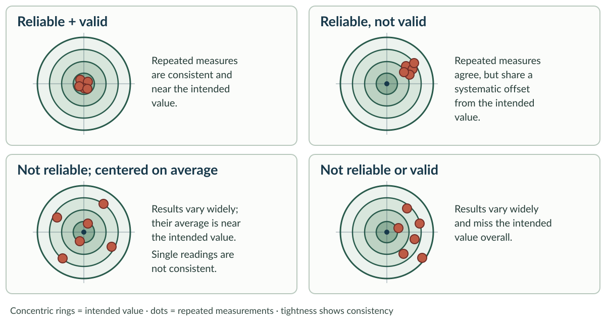
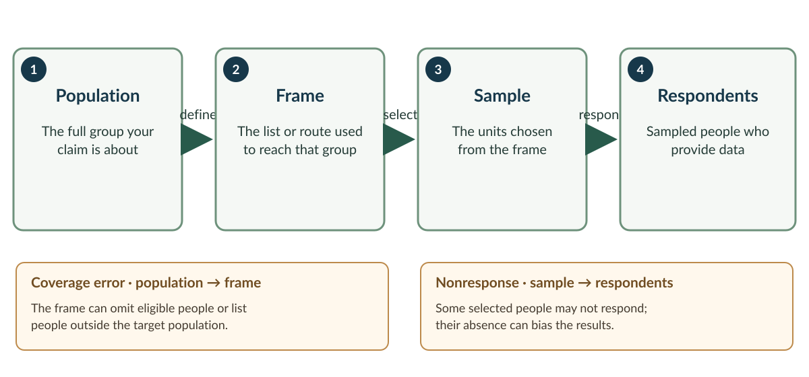

## Forty thousand dollars, two questions

Willow Bay needs evidence about:

1. how often above-no-wake passages occur; and
2. how users explain compliance, access, and fairness.

<br>

**Which question can numeric data answer well—and what could those numbers not
tell us?**

::: notes
Time: 2 minutes. Source: Week 12 case brief; Chapter 14 §14.2. Open with the research charge. Keep causation about bird decline outside the study.
:::

## What you should be able to do

- Match a quantitative design to the inference it supports.
- Distinguish target population, sampling frame, sample, and respondent.
- Diagnose coverage, sampling, nonresponse, and measurement error.
- Bound conclusions from observation, questionnaires, and secondary data.

::: notes
Time: 1 minute. Source: Chapter 14 guiding questions and §§14.3–14.7.
:::

## Quantitative describes with numbers

Quantitative research collects numeric data: counts, measurements, categories
coded as numbers, and scales.

<br>

Its strength is structured comparison and, with a suitable design, inference
beyond observed cases.

<br>

Numbers do not make a claim objective or causal by themselves.

::: notes
Time: 2 minutes. Source: Chapter 14 §§14.2 and 14.8. Ask for one numeric Willow Bay variable.
:::

## Variable type constrains analysis

- **Dichotomous:** two categories—wake observed / not observed.
- **Categorical:** unordered or ordered categories—vessel type; support level.
- **Continuous:** measured along a numeric scale—minutes in the bay.

<br>

Do not treat labels as though distances between them are known.

::: notes
Time: 1 minute. Source: Chapter 14 §14.2.1 and Table 14.1.
:::

## Reliability and validity ask different questions

**Reliability:** Would the measurement or procedure produce consistent results?

<br>

**Validity:** Does the design and measurement accurately support the intended
interpretation?

<br>

Two observers can agree perfectly on a flawed definition: reliable, not valid.

::: notes
Time: 2 minutes. Source: Chapter 14 §14.2.2 and Table 14.2. Use the 31/40 observer agreement as the reliability warning.
:::

## A target separates consistency from accuracy

{width=920px fig-alt="Four targets compare repeated measurements. A tight cluster at center is reliable and valid; a tight cluster off-center is reliable but not valid; a dispersed cluster centered on average is not reliable but is centered on average; a dispersed off-center cluster is neither reliable nor valid. Rings mark the intended value, and dots mark repeated measurements. The target is an analogy; validity depends on the intended interpretation."}

::: notes
Time: 2 minutes. Source: Chapter 14 §14.2.2 and Table 14.2. Treat the bullseye as the intended value and each dot as one repeated measurement. Tightness illustrates reliability; distance from the center illustrates accuracy in this analogy. A tight cluster can be consistently biased, like two observers agreeing on a flawed definition. In real research, validity concerns whether the design and measurement support the intended interpretation, not simply whether a value lands on a physical target.
:::

## Three quantitative design families

```{r}
#| label: quantitative-design-families-table
#| echo: false
#| output: asis

source("../table-style.R")

data.frame(
  Design = c("Experimental", "Quasi-experimental", "Descriptive non-experimental"),
  Intervention = c("Yes", "Yes or natural change", "No"),
  `Random assignment` = c("Yes", "No", "No"),
  `Strongest typical claim` = c(
    "Causal effect",
    "Plausible effect, with threats",
    "Pattern, amount, or association"
  ),
  check.names = FALSE
) |>
  nres315_slide_table(font_size = 20, header_font_size = 21, row_padding = 8)
```

::: notes
Time: 1 minute. Source: Chapter 14 §14.3. Stress that method and design are separate; a questionnaire can appear in any family.
:::

## Experiments create a counterfactual

Random assignment makes intervention and control groups comparable on average.

<br>

If outcomes then differ, the intervention is a stronger explanation.

<br>

Many management questions cannot ethically or practically randomize people,
places, or policies.

::: notes
Time: 2 minutes. Source: Chapter 14 §14.3.1.
:::

## Quasi-experiments use imperfect comparisons

**<u>Before–after:</u>** Compare the same site before and after an action.

<br>

At Willow Bay, compare above-wake passages before and after a sign pilot.
Season, weather, or other changes could explain a shift.

<br>

**<u>Treated–untreated:</u>** Compare a site receiving an action with a similar
site that does not. Sites may differ before the action begins.

::: notes
Time: 3 minutes. Source: Chapter 14 §14.3.2. These designs use a comparison but do not randomly assign treatment. For before–after, ask what else changed over time; for treated–untreated, ask how the sites differed before treatment. A stronger design may track both sites before and after, while still checking whether the comparison is credible.
:::

## Description is not a failed experiment

Descriptive designs answer what, how much, where, when, and among whom.

<br>

They can guide decisions without identifying a cause.

<br>

Willow Bay passage observation can estimate sampled patterns; it cannot prove
that wakes caused the decline in nests.

::: notes
Time: 2 minutes. Source: Chapter 14 §14.3.3; Week 12 brief.
:::

## Why do a descriptive study?

- Establish a baseline or estimate how often and how much an issue occurs.
- Show where, when, and among whom a pattern appears.
- Monitor change when an experiment is not feasible or ethical.
- Identify questions for a later explanatory study.

<br>

At Willow Bay, a descriptive study can locate passage patterns and guide
monitoring—even when it cannot explain why the pattern occurs.

::: notes
Time: 2 minutes. Source: Chapter 14 §14.3.3. Descriptive evidence can support planning, prioritization, and monitoring. It is especially useful when managers first need a trustworthy account of the pattern, when intervention is not under study, or when randomization is impractical or unethical. Keep the claim descriptive; do not turn a baseline into a causal explanation.
:::

## Population, frame, sample, respondent

**Target population** → everyone the claim is about

**Sampling frame** → operational list used to reach that population

**Sample** → units selected from the frame

**Respondents** → selected people who actually provide data

<br>

These sets rarely match perfectly.

::: notes
Time: 3 minutes. Source: Chapter 14 §14.4 and key terms. Have students apply all four to the boat-owner questionnaire.
:::

## Four steps from population to respondents

{width=960px fig-alt="A four-step flow moves from target population to sampling frame, selected sample, and respondents. The frame may omit eligible people or include ineligible ones, creating coverage error. Some selected people may not respond, creating nonresponse error. The groups do not necessarily match perfectly."}

::: notes
Time: 1 minute. Source: Chapter 14 §§14.4 and 14.7.1, 14.7.3. Trace the four groups from left to right. Ask where missing target users enter the account and where selected nonrespondents drop out.
:::

## Probability sampling supports population inference

Every unit has a **known, non-zero chance** of selection.

<br>

Random or systematic selection can reduce selection bias and quantify sampling
uncertainty—if the frame and implementation are sound.

<br>

Probability selection does not guarantee response.

::: notes
Time: 2 minutes. Source: Chapter 14 §14.4.1.
:::

## A census does not cure a bad frame

Contacting every registered boat owner is a census of that list.

<br>

It is not a census of Willow Bay users, because the list includes nonusers and
omits many actual users.

<br>

Define the claim from the population—not from the convenience of the list.

::: notes
Time: 2 minutes. Source: Chapter 14 §14.4.2 and §14.7.1.
:::

## Three common quantitative methods

- **Questionnaires:** structured self-reports.
- **Behavioral observation:** systematic records of actions or traces.
- **Secondary data:** records collected previously for another purpose.

<br>

The method should follow the question. Self-report and observed behavior are
different evidence.

::: notes
Time: 1 minute. Source: Chapter 14 §14.5.
:::

## Observation needs a protocol

Time sampling records behavior during selected intervals; event sampling
records a specified event and its context.

<br>

Willow Bay uses 36 randomly selected two-hour periods, stratified across days
and times. The claim concerns those sampled temporal conditions—not every moment.

::: notes
Time: 1 minute. Source: Chapter 14 §14.5.2; Week 12 brief.
:::

## Secondary data inherit their history

Existing complaints and counters can be efficient and reveal patterns.

<br>

But categories, missing cases, collection purposes, quality, and timing may not
fit the new question. Differences among records can reflect methods rather than
real differences.

::: notes
Time: 1 minute. Source: Chapter 14 §14.5.3.
:::

## Survey research is more than a questionnaire

A survey integrates the research question, target population, frame, contact
and response modes, questionnaire, sample, administration, and analysis.

<br>

A **pre-test** checks the instrument; a **pilot test** trials the larger process.

::: notes
Time: 2 minutes. Source: Chapter 14 §14.6.
:::

## Four cornerstones organize survey error

1. **Coverage:** Does the frame include the target population?
2. **Sampling:** What uncertainty comes from observing a subset?
3. **Nonresponse:** Do respondents differ from nonrespondents?
4. **Measurement:** Do answers reflect the intended variable?

::: notes
Time: 2 minutes. Source: Chapter 14 §14.7. These four are the core diagnostic for Friday.
:::

## Coverage comes before sample size

Undercoverage omits eligible units; overcoverage includes ineligible ones.

<br>

A huge sample from registered owners cannot represent unlisted paddlers or
visitors. Increasing the number selected does not add missing kinds of people.

::: notes
Time: 2 minutes. Source: Chapter 14 §14.7.1. Distinguish coverage from low response.
:::

## Sampling error is expected

A random sample will differ from the population by chance.

<br>

Larger representative samples usually improve precision, expressed through a
margin of sampling error and confidence level.

<br>

Those quantities do not measure coverage, nonresponse, or wording bias.

::: notes
Time: 2 minutes. Source: Chapter 14 §14.7.2.
:::

## Nonresponse is about difference, not count

Unit nonresponse: a selected person provides no survey.

Item nonresponse: a respondent skips a question.

<br>

Error arises when nonrespondents differ systematically on what matters. A high
number of responses does not make that threat disappear.

::: notes
Time: 2 minutes. Source: Chapter 14 §14.7.3.
:::

## Measurement error can be designed in

“Do you support the reasonable quiet-water rule needed to save birds?”

<br>

This item signals the desired answer and embeds untested claims. It does not
cleanly measure support.

<br>

Use neutral wording, one idea at a time, suitable response options, and a
realistic recall period.

::: notes
Time: 3 minutes. Source: Chapter 14 §14.7.4; Week 12 brief. Ask students to rewrite the question before showing suggestions verbally.
:::

## Diagnose the error source

Match each problem:

1. Paddlers absent from the contact list
2. Selected nonusers ignore the invitation
3. “Reasonable rule needed to save birds”
4. Different results from two random samples

<br>

**Coverage, nonresponse, measurement, or sampling?**

::: notes
Time: 2 minutes. Source: Chapter 14 §14.7.
:::

## Check the diagnosis

1. Missing paddlers → **coverage**
2. Selected people do not answer and differ → **nonresponse**
3. Leading wording → **measurement**
4. Chance sample differences → **sampling**

<br>

Name the mechanism; “bias” alone is not a diagnosis.

::: notes
Time: 1 minute. Source: Chapter 14 §14.7.
:::

## Say what the observations can support

Ask: Of the passages observers actually recorded, how many met the study's
above-wake rule?

<br>

**X** = observed passages classified above-wake.  **Y** = all observed passages.

<br>

Report: “During the sampled periods, **X of Y** observed passages met the
above-wake rule.” This describes those periods; it does not explain the bird
decline or measure public support.

::: notes
Time: 2 minutes. Source: Chapter 14 §§14.3, 14.5, 14.7. Explain that X and Y are placeholders for study results, not missing case facts. The count or proportion describes sampled periods only; broader estimates depend on the sampling design. It cannot establish a cause of bird decline or how most bay users feel. Preview Wednesday: explanations and meanings require other evidence.
:::

## Before Wednesday

Read Chapter 15 with one question in mind:

**If observation shows when noncompliance occurs, how could we learn what those
actions mean to different users—and make that interpretation trustworthy?**

::: notes
Time: 1 minute. Total core time: 50 minutes. Source: Chapter 15 §§15.2–15.5.
:::
